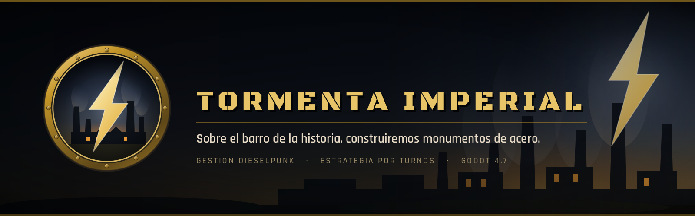
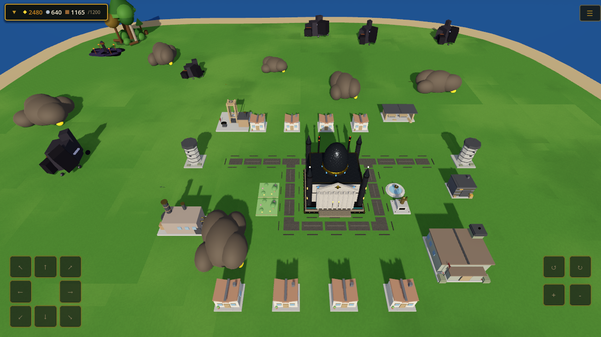
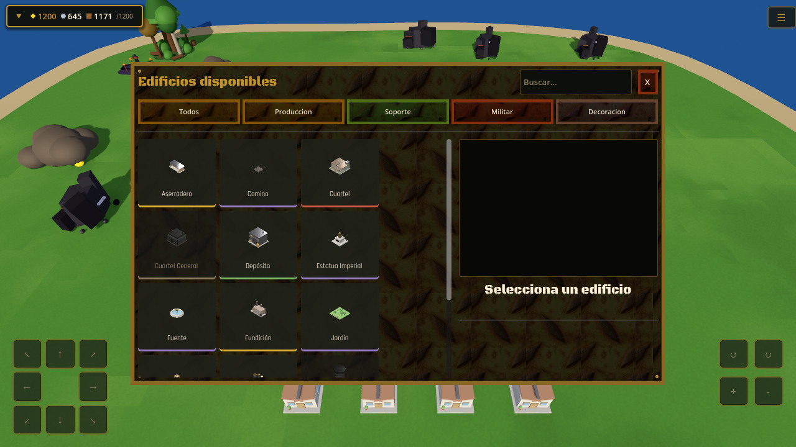
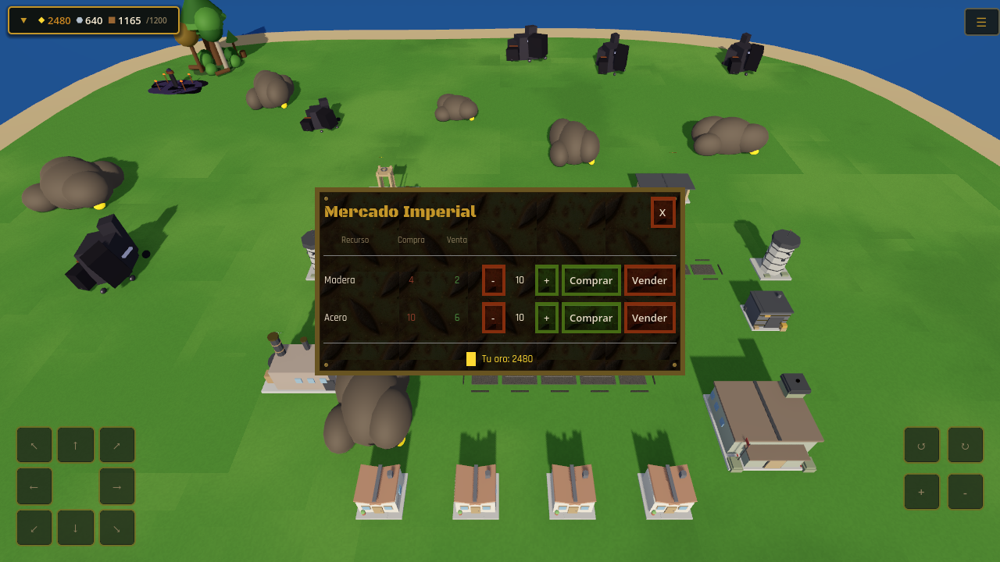
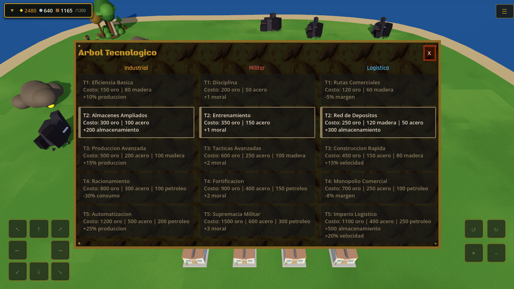
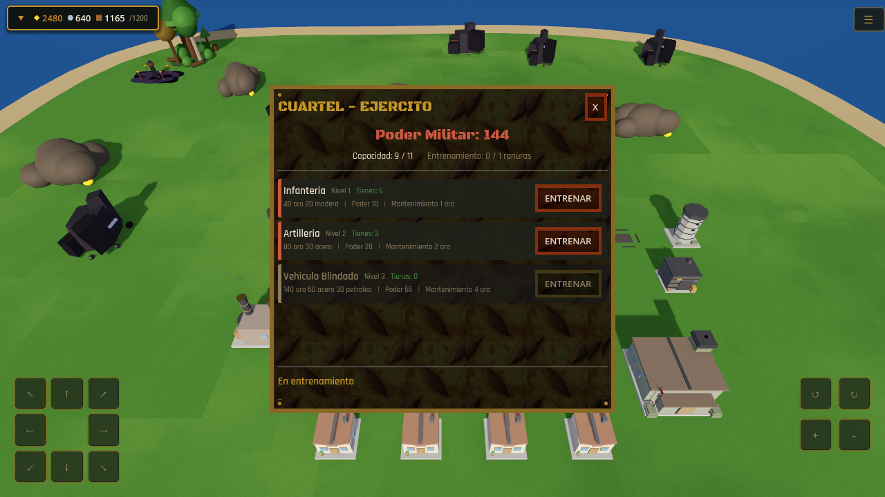

<p align="center">
  
</p>

<p align="center">
  
  
  
  
</p>

<p align="center">
  <strong>Un imperio industrial se levanta sobre una isla de barro. La tormenta ya viene.</strong>
</p>

---

## Qué es

**Tormenta Imperial** es un juego **dieselpunk de gestión de base y estrategia por turnos**, hecho en Godot 4.7.

Llegas a una isla generada proceduralmente (cada una con su costa, sus bahías y cabos, sus bosques y sus vetas) con un núcleo, 300 de oro, 200 de madera y 80 de comida. A partir de ahí, todo lo que tengas lo habrás construido: granjas, aserraderos que muerden el bosque, minas, una fundición que enciende la era del acero, una refinería que abre la del petróleo. Todo se une al núcleo por carretera, y tus trabajadores van andando por ella. Tu gente trabaja, come y **tiene moral** — y la moral decide si tu imperio produce o se para.

Cuando entrenes un ejército, esas tropas saldrán de tu economía y volverán —o no— a ella. Porque la Tormenta Imperial vuelve: apaga el cielo, rompe lo que construiste y manda a los Tasadores a cobrar el Diezmo. Ese cobro se pelea en un tablero de 8x8 con lo que tengas en casa.

> *"Sobre el barro de la historia, construiremos monumentos de acero."*

## Así se ve

<p align="center">
  
</p>

<p align="center">
  <em>Mitad de campaña: era industrial, 26 habitantes, moral alta y un ejército pequeño ya en pie.</em><br>
  <sub>Capturas de septiembre de 2026, anteriores a las carreteras, a la isla irregular y al aspecto de maqueta de la 1.0. Están pendientes de rehacer.</sub>
</p>

| | |
|---|---|
|  |  |
| **Construcción** — catálogo de edificios (hoy 27, diez de ellos decoraciones), con requisitos y coste a la vista. | **Mercado Imperial** — compra y venta con precios que flotan según lo que hagas. |
|  |  |
| **Tecnología** — 15 mejoras en tres ramas, cinco escalones cada una. | **Ejército** — entrenamiento por ranuras, poder militar y mantenimiento en oro. |

> Capturas del juego corriendo, generadas por [`tools/showcase_shots.gd`](tools/showcase_shots.gd). No son montajes.

## Descargar y jugar

El juego es **gratis** e independiente: se reparte como `.exe` para Windows y APK para Android (tableta primero), sin tienda. También circula en enlaces directos; descárgalo solo de aquí o de alguien de confianza:

- **GitHub Releases:** [github.com/bryansank/tormenta-imperial/releases](https://github.com/bryansank/tormenta-imperial/releases)

| | Windows | Android |
|---|---|---|
| Necesitas | Windows 10/11 de 64 bits y una gráfica con Vulkan | Android 7 o superior, 64 bits (ARM64), con Vulkan |
| Cómo se abre | Descomprimir el zip y abrir `TormentaImperial.exe` (no hay instalador) | Instalar el `.apk` a mano, permitiendo "orígenes desconocidos" para esa app |

**Si Windows dice "Windows protegió su PC":** es SmartScreen, que avisa de los programas nuevos sin firma digital de pago. No es un virus. Pulsa **Más información → Ejecutar de todas formas**; solo pasa la primera vez.

Cada zip trae un `LEEME.txt` (en español e inglés) con la instalación, los controles, dónde se guarda la partida y cómo desinstalar. El juego no usa internet ni pide permisos: la partida se guarda en tu equipo.

## El bucle

1. **Construye** para producir: cada edificio necesita trabajadores y una carretera hasta el núcleo, y los trabajadores necesitan viviendas. Lo producido espera en cada edificio hasta que lo **recoges** con un toque; si se llena, el edificio para. Los edificios avanzados piden además materiales del taller (tablones, lingotes, vigas y combustible).
2. **Sostén a tu gente**: cada habitante come. La comida sale de las granjas (cosechas de 1, 5 o 20 minutos) y del mercado. Si falta, la moral cae y con ella la producción.
3. **Comercia** en el Mercado Imperial (levanta antes el edificio del Mercado), con precios que flotan según lo que compres y vendas.
4. **Progresa** por tres eras: Frontera → Industrial → Petróleo. Cada una desbloquea un recurso y con él media docena de decisiones nuevas.
5. **Investiga** en el Laboratorio quince tecnologías en tres ramas, con bonificaciones permanentes.
6. **Entrena un ejército** en el Cuartel — y págale el mantenimiento, todos los turnos, en oro.
7. **Sobrevive** a la Tormenta Imperial: ceniza, edificios en ruinas y el Diezmo, que se paga o se pelea.
8. **Aguanta la Auditoría Final.** En la Campaña, subir el Cuartel General al nivel 3 no gana la partida: convoca a la Regencia. De 3 a 5 oleadas seguidas contra la guarnición que tengas en casa, sin reentrenar entre medias. Sobrevivirlas para la Tormenta para siempre — y eso sí es ganar.

## Lo que lo hace distinto

**La moral no es una barra que cuidas: es el sistema que lo conecta todo.** Multiplica tu producción, y también decide la iniciativa de tus unidades en el tablero y lo fuerte que golpean. Las bajas la hunden al volver a casa: una victoria cara puede dejar al pueblo peor que antes de salir. Un imperio desmoralizado reacciona tarde y golpea flojo.

Ningún otro juego del género cruza esas dos mitades. Esa es la apuesta.

## Estado

La **versión 1.0 está en preparación**. El **juego se puede jugar de principio a fin**: economía con comida y materiales, recoger la producción, población y moral, mercado, árbol tecnológico, ejército, eventos aleatorios, progresión offline, la Tormenta y su Diezmo, el combate y la Auditoría Final. Alrededor: el rango del gobernador y un **país propio** (nombre y bandera hecha por piezas), **día y noche**, sonido y ambiente, **hasta cinco partidas guardadas**, velocidad x1 / x2, **cuatro modos** (Campaña, Constructor, Supervivencia y Sandbox; hoy la partida nueva solo ofrece la Campaña y los otros tres están apartados), una **vista 2D** además de la 3D, una **interfaz configurable** por dispositivo (PC, tableta, móvil) con juego táctil, una **calidad gráfica "Mínima"** para equipos flojos, un **prólogo, un tutorial guiado y un índice de ayudas**, y exportados para **Windows y Android**.

Lo que aún no está: la campaña se midió entera con tiempos reales (diez de diez partidas simuladas ganadas, de 2 h 18 min a 4 h) **antes** de las carreteras, los materiales, la comida y la isla irregular, así que falta volver a medirla; el rendimiento tampoco se ha vuelto a medir tras las optimizaciones; y nadie ha jugado aún una partida entera en una tableta real. Antes de publicar entra una primera tanda de cambios al ciclo de juego, después de jugarlo. Ya están los topes de edificios que suben con la era, diez decoraciones baratas y sin tope, y un edificio que "salta" al terminarse. Faltan las escaramuzas más cortas, visibles y que den cosas que la colonia no tiene, y un primer combate guiado. Está en curso; el detalle, en [`docs/13-roadmap.md`](docs/13-roadmap.md).

El **combate PVE por turnos está en el juego**: un tablero de 8x8, orden de iniciativa, mover/atacar/defender/esperar, IA enemiga, ventaja por tipo de unidad, el Diezmo peleado en vez de pagado, y la Auditoría Final que cierra la partida. En 3D se ve como una maqueta: por defecto los dos bandos frente a frente sin casillas a la vista, o el tablero 8x8 si lo prefieres en Ajustes. Todo el modelo vive en `scripts/combat/` como objetos puros, sin nodos ni señales, y se prueba en headless con gdUnit4.

| Pieza | Estado |
|---|---|
| Tablero táctico, turnos, IA enemiga (`Encounter`, `CombatAI`, `BattleScreen`) | ✅ en el juego |
| Vista de frente y tablero 3D con piezas de juguete del color de tu país | ✅ en el juego |
| Ventaja por tipo: artillería > blindado > infantería > artillería | ✅ en el juego |
| El Diezmo se pelea: guarnición y dotaciones de torre en el tablero | ✅ en el juego |
| Defensa auto-resuelta cuando el tablero ya está ocupado (`AutoResolver`) | ✅ en el juego |
| Auditoría Final: oleadas encadenadas, atrición, perder sin Game Over, reconvocar | ✅ en el juego |
| Expedición roguelike: mapa por semilla, atrición, muerte permanente, draft | ✅ en el juego; se acortará en la 1.0 (incursión de 1 combate y expedición de 3) |
| Partes de guerra: defensa a ciegas, Diezmo cobrado o repelido, oleadas del asedio | ✅ en el juego |
| Enseñar el combate: primer combate guiado, fichas de unidad, daño previsto | 🚧 en curso |

Detalle técnico en [`docs/15-combat.md`](docs/15-combat.md); especificación en [`specs/001-combate-pve/`](specs/001-combate-pve/).

## Bajo el capó

| | |
|---|---|
| **Motor** | Godot 4.7 (.NET/mono), renderer Forward+ en PC y Mobile en Android (y en un PC con la calidad "Mínima") |
| **Lenguaje** | GDScript — unas 61.000 líneas en 155 scripts, 30 escenas |
| **Arquitectura** | Servicio–señal–componente: 27 autoloads de juego que se **avisan** solo por un `EventBus` (126 señales); ningún productor conoce a quien le escucha |
| **Modelos puros** | La lógica de combate, de la Tormenta y del día y la noche vive en `scripts/combat/` y `scripts/storm/` como `RefCounted` sin nodos ni señales: devuelven listas de eventos y un servicio las publica. Por eso se prueban enteras en headless |
| **Balance** | Todo valor ajustable vive en `GameConfig.gd`. Cero números mágicos repartidos por el código |
| **Modelos 3D** | Maqueta de juguete: los 16 edificios principales (la granja con sus bancales que crecen por shader) y las unidades de combate son mallas horneadas con `tools/build_toy_models.gd` a partir de piezas CC0 (KayKit, Kenney) recoloreadas con una paleta común; las diez decoraciones nuevas y la calzada se generan por código, una malla compartida por tipo |
| **Sonido** | 5 temas de música, 34 efectos y 3 ambientes (día, noche y Tormenta); terceros solo CC0, el ambiente sintetizado es obra propia |
| **Guardado** | JSON local, hasta cinco partidas, autoguardado y progresión offline de hasta 8 horas; las peleas no se guardan a medias |
| **Rendimiento** | Tope de FPS por dispositivo, calidad "Mínima" con detección en el primer arranque y una sonda reproducible (`tools/perf_probe.gd`); ver [`docs/26-rendimiento.md`](docs/26-rendimiento.md) |
| **Tests** | gdUnit4: unos 2.070 tests en 158 suites, lanzados siempre con `tools/run_tests.sh`, que les da una carpeta de usuario propia |
| **Exportados** | Windows (`.exe` único) y Android (APK para tableta); ver [`docs/19-exportar.md`](docs/19-exportar.md) |

El proyecto sigue **Spec-Driven Development**: cada pilar pasa por especificación, plan técnico y lista de tareas antes de escribirse. Las reglas que no se negocian están en [`.specify/memory/constitution.md`](.specify/memory/constitution.md).

Documentación por sistema en [`docs/`](docs/INDEX.md) · Guía técnica en [`CLAUDE.md`](CLAUDE.md)

## Estructura

```
tormenta-imperial/
├── scenes/          Main.tscn (3D), Main2D.tscn (2D), la maqueta del combate y una escena por panel
├── scripts/
│   ├── services/    Los autoloads: economía, población, mercado, ejército…
│   ├── combat/      Modelos puros del combate: tablero, IA, expedición, Auditoría
│   ├── combat_view/ La maqueta 3D del combate (solo se ve, no decide nada)
│   ├── storm/       Modelos puros del ciclo de la Tormenta y del día y la noche
│   ├── buildings/   Colocación, parcelas, paleta de maqueta y aspecto de los edificios
│   ├── ui/          Un script por panel, más tema y disposición
│   ├── view2d/      La vista 2D: cámara, isla, colocación y dibujos
│   ├── grid/        Rejilla de 60 a 74 celdas por lado, sorteada por partida, con su máscara de tierra
│   ├── map/         Isla irregular, yacimientos, cielo y luz, trabajadores que andan
│   └── camera/      Cámara ortográfica a 45°
├── data/buildings/  Los 27 edificios, como recursos .tres
├── assets/          Modelos horneados, audio, fuentes, texturas y marca
├── specs/           Especificaciones previas a cada pilar
├── tests/           Suites de gdUnit4
├── qa/maestro/      Flujos de QA en el emulador de tableta Android
├── docs/            Documentación por sistema
└── tools/           Envoltorio de tests, sondas, capturas, marca y texturas
```

## Correrlo

Necesitas **Godot 4.7 (.NET)**. No hay proyecto C# ni dependencias externas.

```bash
git clone https://github.com/bryansank/tormenta-imperial.git
cd tormenta-imperial
godot --path . --editor     # y pulsa F5
```

| Acción | PC | Móvil |
|---|---|---|
| Mover cámara | WASD / flechas / arrastrar el suelo (botón izquierdo o central) | Arrastrar un dedo |
| Zoom | Rueda del ratón | Pellizcar |
| Rotar (3D) | Q / E o arrastrar con el botón derecho | Girar dos dedos |
| Construir | Botón CONSTRUIR | Tocar el sitio y tocar el fantasma o ✓ |
| Recoger lo producido | Clic en el edificio o en su icono | Tocar el edificio o su icono |
| Velocidad x1 / x2 | Botón x1/x2 o F | Botón x1/x2 |
| Menú | ☰ MENÚ o Esc | ☰ MENÚ o el botón atrás |

Desde el editor, `GameConfig.dev_mode` está encendido solo (todo corre cinco veces más rápido); en un exportado está apagado. Para jugar desde el editor con tiempos reales: `godot --path . -- --no-dev`. Vista 2D: `-- --view=2d` o en Ajustes. Para empezar otra: **☰ MENÚ → Menú principal → Nueva partida** (hoy solo ofrece la Campaña). No borra la que tenías: cada partida va a su propio archivo, hasta cinco, y se cambian en **PARTIDAS**.

### Utilidades de desarrollo

```bash
# Regenerar la marca tras tocar los SVG (con ventana, NO headless)
godot --path . -s tools/render_brand.gd        # emblema y banner
godot --path . -s tools/render_branding.gd     # key art

# Tests (siempre por el envoltorio: carpeta de usuario propia, no toca tu partida)
GODOT=godot tools/run_tests.sh
```

---

## Licencia

> **Código disponible, no código abierto.** Este repositorio es público para que el trabajo se pueda **leer, estudiar y evaluar** — no para reutilizarlo.

El código fuente se publica bajo [**PolyForm Strict 1.0.0**](https://polyformproject.org/licenses/strict/1.0.0), una licencia deliberadamente restrictiva.

| Puedes | No puedes |
|---|---|
| Leer y estudiar el código | Redistribuirlo, en fuente o compilado |
| Clonarlo y ejecutarlo en local, para estudio o entretenimiento privado | Crear versiones modificadas, forks o trabajos derivados |
| Citarlo y comentarlo | Usarlo, entero o en parte, con fines comerciales |

Además:

- **Arte, audio, textos y el nombre "Tormenta Imperial"** quedan fuera de esa licencia: **todos los derechos reservados**. Eso incluye el emblema, el banner y el key art de [`assets/branding/`](assets/branding/).
- **Componentes de terceros** —Godot, gdUnit4, Beckett, las fuentes y los assets CC0— conservan sus propias licencias. Están listadas una a una en [THIRD-PARTY-NOTICES.md](THIRD-PARTY-NOTICES.md).

Los términos completos, que son los que mandan, están en [LICENSE](LICENSE).

**¿Necesitas otros términos?** Para uso comercial, educativo o cualquier cosa que la licencia no permita, abre un [issue](https://github.com/bryansank/tormenta-imperial/issues) y lo hablamos. La licencia es estricta por defecto, no por cerrazón.

<p align="center">
  <sub>Copyright © 2026 Bryan Key · Todos los derechos reservados</sub>
</p>
